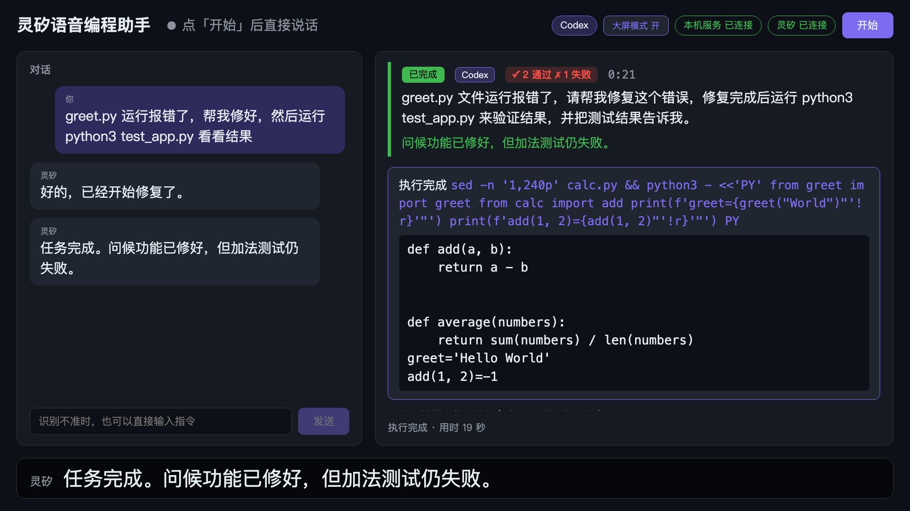

# 灵矽语音编程助手

通过 AirPlay 把编程面板投到大屏，用语音驱动 Claude Code 写代码。语音识别、对话和语音合成由[灵矽 AI 平台](https://linx.qiniu.com/docs/xrobot/)提供。

开发者坐在离屏幕几米的地方说「greet.py 运行报错，帮我修好」，灵矽听懂后调用本机的 Claude Code 去改代码；大屏实时显示 Claude 的每一步和代码 diff，任务结束后灵矽用一句话播报结果。



## 功能

| 功能 | 解决的痛点 |
|---|---|
| 语音下任务：说话 → 灵矽识别 → 灵矽大模型调用本机工具 → Claude Code 执行 | 手不碰键盘也能编程 |
| 大屏实时面板：对话、任务状态与计时、agent 每一步（读/改了哪个文件、跑了什么命令）、红绿 diff | 离屏幕几米也知道 agent 在做什么 |
| 大屏模式：放大当前的 diff 或命令输出、识别测试结果（✓ 通过 ✗ 失败）、底部字幕 | 电视上一眼看到最关键的信息 |
| 多轮接续、语音中止、语音切换 Claude Code / Codex | 像和同事对话一样连续地改代码 |
| 完成后语音播报一句话摘要，细节留在屏幕上 | 不用一直盯着；长输出不适合念 |
| 文字输入兜底 | 识别不准或现场嘈杂时也能继续 |

## 架构

```
浏览器（收音 · 播放 · 面板） ⇄ 本地 WebSocket ⇄ 桥接服务（Node） ⇄ 灵矽云端（WebSocket + 设备端 MCP）
                                                      ⇅
                                    Claude Code 或 Codex（子进程，可语音切换）
Mac 屏幕 ── AirPlay（macOS 自带）──▶ 电视 / 显示器
```

桥接服务以「设备」身份连接灵矽，通过**设备端 MCP** 向灵矽注册 `self.coding.run_task` 和 `self.coding.get_status` 两个工具，灵矽大模型判断是编程需求时沿同一条 WebSocket 调用它们，本机不需要公网地址。详见[架构设计文档](docs/architecture.md)和[灵矽协议技术验证报告](docs/spike-report.md)。

## 环境要求

- macOS（投屏用系统自带的 AirPlay；其余部分在 Linux 上也能运行）
- Node.js 24+、pnpm 10+
- 已登录的 [Claude Code](https://docs.anthropic.com/en/docs/claude-code) 命令行（`claude --version` 能输出版本）
- 可选：已登录的 [Codex](https://github.com/openai/codex) 命令行，用于语音切换到 Codex（本机实测 0.147）
- 灵矽账号（[智控台](https://xrobo.qiniu.com/)）
- Chromium 内核浏览器（Chrome、Edge 等；收音依赖 `AudioContext({ sampleRate: 16000 })`，目前只在 Chromium 内核上实测过）
- Python 3（仅演示项目需要）

## 快速开始

### 1. 安装依赖

```bash
pnpm install
```

### 2. 激活设备

```bash
pnpm activate
```

脚本会打印一个 6 位激活码并等待绑定。在[智控台](https://xrobo.qiniu.com/)：

1. 「智能体管理」里新建或选择一个智能体；
2. 在该智能体的「设备管理」中点「绑定设备」，填入激活码。

绑定后脚本自动取回 token 并退出。设备身份保存在 `~/.voice-coder/linx-device.json`，之后不用再激活。

### 3. 配置智能体

在智能体的「配置角色」页面：

- **角色介绍**：

  ```text
  你是语音编程助手，帮用户用语音指挥 Claude Code 写代码。
  凡是用户提出写代码、改代码、查看项目、跑测试之类的编程需求，都调用 self.coding.run_task，把用户的需求整理成清晰完整的中文指令作为 instruction 参数，然后用一句话告诉用户已经开始。
  用户问进度、问做完没有时，调用 self.coding.get_status。
  回复一律简短口语化，不超过两句话，不要念代码。
  ```

- **技能与扩展 → 意图识别**：选「统一意图识别」。不选的话灵矽不会调用本机工具。
- **大语言模型**：选支持工具调用的模型（如 DeepSeek V4 Flash）。
- 建议在「对话与视觉」里把空闲超时调长；不调也能用，桥接服务会在需要时自动重连。
- 点右上角「保存配置」。

本机工具由桥接服务直接上报，**不需要**在「MCP 编辑」里关联任何服务。

### 4. 准备演示项目

```bash
pnpm demo:prepare
```

把 `demo/` 复制到 `/tmp/voice-coder-demo`。里面是一个预埋了两个 bug 的小 Python 项目，`python3 test_app.py` 会有两个测试失败；`CLAUDE.md` 要求 Claude 只做正常测试，缩短演示时间。每次演示前重新运行即可恢复原样。

### 5. 启动

```bash
pnpm build
PROJECT_DIR=/tmp/voice-coder-demo pnpm start
```

浏览器打开 <http://localhost:8787>，点「开始」并允许麦克风，然后直接说话。

| 环境变量 | 默认值 | 说明 |
|---|---|---|
| `PROJECT_DIR` | 无（必填） | Claude Code 的工作目录，也就是要改的项目 |
| `PORT` | `8787` | 本地服务端口 |
| `TASK_TIMEOUT_MIN` | `10` | 单个任务的最长运行时间（分钟），超时终止并播报 |
| `CODE_AGENT` | `claude` | 默认使用的编程 agent：`claude` 或 `codex`，运行中可以语音切换 |

### 6. 投屏到电视

1. Mac 和电视（Apple TV 或支持 AirPlay 2 的电视）连同一个网络；
2. 打开控制中心 →「屏幕镜像」→ 选择电视（菜单名称以系统版本为准）；
3. 推荐选扩展显示（「用作独立显示器」）：把浏览器窗口拖到电视上，按 `Ctrl+Cmd+F` 全屏；笔记本屏幕可以继续看桥接服务的日志。选镜像也可以。

面板按 1080p 设计，字号随屏幕宽度缩放。窗口宽度 ≥ 1600 像素时自动进入大屏模式（焦点卡片 + 字幕），也可以点顶栏的「大屏模式」开关切换。

## 演示建议

1. 「greet.py 运行报错，帮我看看」——灵矽回答「已经开始」，面板显示 Claude 读文件、改代码、跑测试，约一两分钟后播报结果；
2. 任务进行中问「做完了吗」——灵矽调用 `get_status` 报告进度；
3. 「给刚才修的那个函数加上参数校验，名字为空时抛异常」——Claude 接着上一轮的会话做，记得「刚才那个函数」是哪个，面板上标「接续上一轮」；
4. 「新任务：calc.py 里的加法写错了，修一下」——开新会话；
5. 任务进行中说「停下，先别改了」——任务立即中止；
6. 「换成 Codex」，再提一个需求——由 Codex 执行，大屏标出当前 agent；「换回 Claude Code」切回来，仍能接着之前的 Claude 会话。

笔记本外放时建议戴耳机，或把音量调低；网页在灵矽说话期间不上传麦克风（半双工），但离麦克风太近仍可能误识别。

## 开发

```bash
pnpm test        # bridge 与 web 的单元测试
pnpm typecheck   # TypeScript 类型检查
pnpm dev:web     # 网页开发服务器（/ws 代理到 8787），桥接服务另开终端 pnpm start
pnpm --filter bridge spike text "帮我看看项目"   # 协议验证脚本，见 docs/spike-report.md
```

目录结构：

```
bridge/   本地桥接服务：灵矽客户端、设备端 MCP、任务管理、Claude Code 运行器、本地服务
web/      网页：收音、播放、大屏面板
demo/     演示项目模板
docs/     架构设计、协议验证报告、截图
```

## 已知限制

- Claude Code 以 `--permission-mode auto` 运行。该模式依赖 Anthropic 的安全分类模型，分类模型暂时不可用时 Bash 命令会被拒绝，Claude 会反复重试，直到任务超时。
- 不支持语音打断灵矽说话（半双工）。
- 同一时间只执行一个任务。
- 会话 id 只存在内存里，桥接服务重启后从新会话开始。
- 网页只在 Chromium 内核浏览器上实测过，Safari、Firefox 未测试。

## 文档

- [架构设计](docs/architecture.md)：架构、模块规格、接口、核心流程、边界情况
- [灵矽协议技术验证报告](docs/spike-report.md)：实测结论与据此做的方案调整
