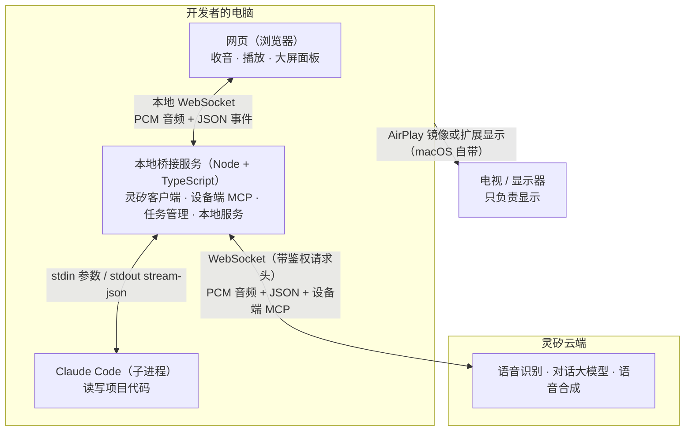
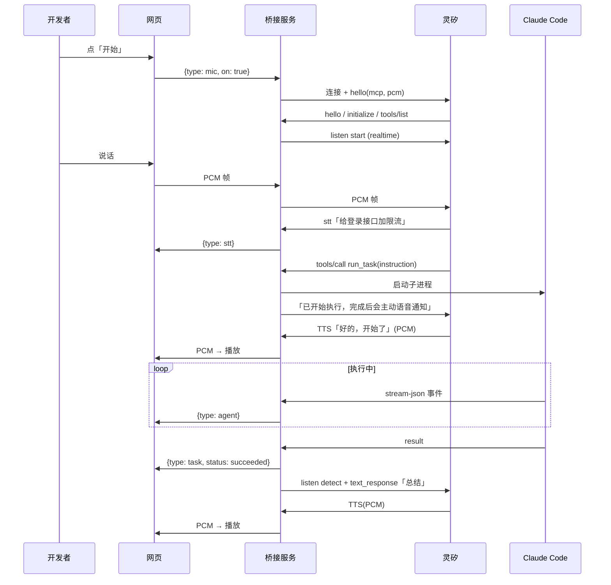

# 架构设计文档

## 1. 项目定位

**灵矽语音编程助手**：开发者坐在离屏幕几米的地方，不碰键盘，用语音给 Claude Code 下编程任务。大屏（通过 AirPlay 投屏）实时显示 agent 的每一步，任务完成后由灵矽语音播报结果。

### 1.1 MVP 范围

| 功能 | 解决的痛点 | 状态 |
|---|---|---|
| F1 语音下任务：说话 → 灵矽识别 → 灵矽大模型调用本机工具 → Claude Code 执行 | 手不碰键盘也能编程 | 开发中 |
| F2 大屏实时面板：识别文字、agent 每一步（读/改了哪个文件、跑了什么命令）、diff | 离屏幕几米也知道 agent 在做什么 | 开发中 |
| F3 完成后语音播报一两句摘要，细节留在屏幕上 | 不用一直盯着；长输出不适合念 | 开发中 |

暂不做（MVP 之后）：多轮接续、危险操作语音确认、语音打断、识别文字上屏确认、切换项目。

## 2. 系统架构

### 2.1 总览



### 2.2 和最初设想的差异

最初的草图里网页直连灵矽，另有一条「灵矽调用本机（需公网地址）」的备选路线。实测和查阅文档后调整为上图，原因：

| 调整 | 原因 | 证据 |
|---|---|---|
| 灵矽连接从网页挪到桥接服务 | 灵矽握手要求 `Authorization`、`Device-Id`、`Client-Id` 请求头，浏览器原生 WebSocket 不能设置自定义请求头 | [灵矽 WebSocket 协议文档](https://linx.qiniu.com/docs/xrobot/platform/websocket) |
| 去掉「需公网地址」的备选路线 | 灵矽支持**设备端 MCP**：设备在 hello 里声明 `mcp: true`，灵矽沿同一条 WebSocket 下发 `tools/list`、`tools/call`，本机无需暴露端口 | `docs/spike-report.md` 实测 |
| 去掉 Opus 编解码 | hello 声明 PCM 后，灵矽上下行都用 16kHz PCM（与文档「下行固定 Opus」不一致） | `docs/spike-report.md` 实测 |

### 2.3 架构选型

只用一个本地 Node 进程承载全部后端逻辑，不拆服务、不引入数据库或消息队列。理由：单用户、单机演示场景，状态只有「当前连接」和「当前任务」，放内存即可；进程重启丢失状态可以接受。

## 3. 模块划分

```
bridge/                     本地桥接服务
  src/linx/device.ts        设备身份：伪 MAC + Client-Id，存 ~/.voice-coder/linx-device.json
  src/linx/ota.ts           OTA 激活：上报设备、取激活码或 token
  src/linx/mcp.ts           设备端 MCP 请求处理（initialize / tools/list / tools/call）
  src/linx/client.ts        灵矽 WebSocket 客户端：握手、收发音频、重连、屏蔽告别语
  src/agent/claude.ts       启动 Claude Code 子进程，把 stream-json 解析成统一事件
  src/agent/task.ts         任务管理：单任务、去重、状态查询、完成回调
  src/tools.ts              两个 MCP 工具的定义，连接任务管理
  src/server.ts             本地 HTTP + WebSocket：托管网页、转发音频和事件
  src/index.ts              组装以上模块
  scripts/activate.ts       pnpm activate：设备激活
  scripts/spike.ts          协议验证脚本
bridge/src/protocol.ts      桥接服务与网页共用的消息类型（只含类型，不依赖 Node）
web/                        网页（Vite + React）
  src/audio/pcm.ts          Float32 与 16 位 PCM 互转、按 20ms 分帧
  src/audio/capture.ts      麦克风采集；AudioContext({sampleRate:16000}) 负责重采样（已在 Chromium 内核实测）
  src/audio/capture-worklet.ts  AudioWorklet，在音频线程里分帧
  src/audio/player.ts       按到达顺序无缝播放 16kHz PCM
  src/bridge.ts             与桥接服务的 WebSocket 连接，断开每秒重连
  src/state.ts              服务端消息归约成界面状态（纯函数）
  src/useVoiceBridge.ts     组合连接、收音、播放，实现半双工
  src/App.tsx               大屏面板
docs/                       架构、验证报告
```

### 3.1 模块职责与依赖

| 模块 | 职责 | 依赖 | 不负责 |
|---|---|---|---|
| `linx/device` | 生成并持久化设备身份 | 文件系统 | 网络 |
| `linx/ota` | OTA 上报，解析激活码或 token；未知响应一律抛错 | `device` 的类型 | 重试 |
| `linx/mcp` | 把 JSON-RPC 请求分派给工具，包装结果和错误 | 无 | 工具业务逻辑 |
| `linx/client` | 维持与灵矽的连接，对外暴露事件和收发方法 | `ws`、`mcp` | 取 token（由调用方注入） |
| `agent/claude` | 启动和终止 Claude Code，逐行解析输出 | `child_process` | 任务排队 |
| `agent/task` | 同一时间只跑一个任务，记录状态，结束时回调 | `claude` | 语音、网络 |
| `tools` | 定义 `self.coding.run_task`、`self.coding.get_status` | `task` | 协议细节 |
| `server` | 托管网页，桥接网页与灵矽客户端、任务管理 | `ws`、`node:http` | 业务判断 |
| `web` | 收音、播放、展示 | 浏览器 API | 任何业务逻辑 |

依赖方向单向：`index` → `server` / `tools` → `task` → `claude`；`index` → `client` → `mcp`。`linx/*` 和 `agent/*` 互不依赖，由 `index` 组装。

## 4. 接口定义

### 4.1 设备端 MCP 工具（桥接服务 → 灵矽）

| 工具 | 参数 | 返回给大模型的文字 |
|---|---|---|
| `self.coding.run_task` | `instruction: string`：整理后的完整中文编程指令 | 立即返回。空闲时：「已开始执行，完成后会主动语音通知」；忙碌时：「上一个任务还在执行：<指令摘要>」 |
| `self.coding.get_status` | 无 | 当前任务的状态、已运行时长；已结束则给出摘要 |

约束（来自实测）：工具调用超时在 10–30 秒之间，超时后灵矽会重发相同调用，所以 `run_task` 必须立即返回，并对执行中的相同指令去重。返回文字不能写「已完成」，否则大模型会提前宣布完成。

### 4.2 本地 WebSocket（网页 ↔ 桥接服务，`ws://localhost:8787/ws`）

二进制帧：两个方向都是 16kHz、单声道、16 位小端 PCM，每帧 20ms（640 字节）。网页发的是麦克风音频，桥接服务发的是灵矽的语音合成音频。

网页 → 桥接服务（JSON）：

| type | 字段 | 含义 |
|---|---|---|
| `mic` | `on: boolean` | 开始或停止收音，对应灵矽 `listen start/stop`（realtime 模式） |
| `text` | `text: string` | 文字输入兜底，对应灵矽 `listen detect` |

桥接服务 → 网页（JSON）：

| type | 字段 | 含义 |
|---|---|---|
| `linx` | `status: 'disconnected' \| 'connecting' \| 'connected'` | 灵矽连接状态 |
| `stt` | `text` | 灵矽识别出的用户语音 |
| `tts` | `state: 'start' \| 'sentence' \| 'stop'`，`text?` | 灵矽正在说的话 |
| `task` | `TaskState` | 任务状态变化 |
| `agent` | `AgentEvent` | Claude Code 的每一步 |

```ts
interface TaskState {
  id: string;
  instruction: string;
  status: 'running' | 'succeeded' | 'failed';
  startedAt: number;
  endedAt?: number;
  summary?: string;   // 一句话，用于语音播报
  error?: string;     // 失败时的错误细节，只显示在屏幕上
}

type AgentEvent =
  | { kind: 'start'; sessionId: string; model: string }
  | { kind: 'thinking'; text: string }
  | { kind: 'text'; text: string }
  | { kind: 'tool'; id: string; name: string; summary: string }            // summary 为文件路径、命令或搜索词
  | { kind: 'diff'; id: string; file: string; before: string; after: string } // Edit / Write 工具
  | { kind: 'tool_result'; id: string; isError: boolean; output: string }   // output 截断到 2000 字符
  | { kind: 'done'; isError: boolean; result: string; durationMs: number; costUsd: number };
```

### 4.3 Claude Code 调用方式

```
claude -p <instruction> --output-format stream-json --verbose --permission-mode auto
       --permission-prompts none       # 默认 host 会等宿主回答权限确认，没有宿主时进程挂起
       --append-system-prompt <要求最后一行输出「总结：<一句话>」>
```

工作目录为环境变量 `PROJECT_DIR`。逐行解析 stdout：`system/init` → `start`，`assistant` 中的 `thinking` / `text` / `tool_use` → 对应事件（`Edit`、`Write` 额外产出 `diff`），`user` 中的 `tool_result` → `tool_result`，`result` → `done`。

## 5. 核心流程

### 5.1 语音下任务到完成播报



### 5.2 连接保活

- 只在「网页正在收音」或「有待发送的播报」时保持连接：灵矽按设备会话时长扣减资源包（[资源包时长扣减规则](https://linx.qiniu.com/docs/xrobot/billing/resource-usage-billing)），后台无限重连会白白消耗时长。
- 灵矽空闲 120 秒会发 `goodbye`、播一句告别语，然后断开（实测）。桥接服务丢弃 `goodbye` 之后到下一次 `tts stop` 之间的语音和文字，再按需重连。
- 每次连接前重新走 OTA 取 token，不缓存 token。
- **回复 `tools/list` 之后才算就绪**，就绪后才发 `listen start` 和排队的消息。实测：hello 后立即发文字，灵矽大模型在还没有工具时处理这句话，会口头答应「已经开始」却不调用工具。灵矽一直不发 `tools/list` 时，hello 后 3 秒按就绪处理并打日志。
- 灵矽会把 `text_response` 播报内容当作 `stt` 回传（实测），客户端记下自己发出的播报，收到相同文字的 `stt` 时不转发给网页。

## 6. 边界情况

| 情况 | 处理 |
|---|---|
| 灵矽连接断开 | 需要连接时按 0、1、2、5、10 秒退避重连，网页显示连接状态 |
| 任务完成时连接已断 | 播报进入待发队列，触发重连，hello 后发送 |
| 灵矽重复下发同一工具调用 | 执行中的任务指令相同则返回「已在执行」，不重复启动 |
| 任务执行中又来新任务 | 拒绝，返回当前任务摘要 |
| Claude 的 result 标记失败 | 播报「任务失败：<Claude 给出的总结>」，stderr 末尾 8 行显示在屏幕上 |
| Claude Code 非零退出或无 `result` 事件 | 播报「任务失败，详情请看屏幕」，stderr 末尾 8 行（没有则写退出码）显示在屏幕上。stderr 里常有与任务无关的告警，不适合念出来 |
| 任务超时（默认 10 分钟，`TASK_TIMEOUT_MIN` 可调） | 终止进程，播报「任务超过 N 分钟没有完成，已经中止」。实测 `auto` 权限模式依赖的安全分类模型暂时不可用时，Bash 会一直被拒绝，Claude 反复重试停不下来 |
| Claude 输出里没有「总结：」行 | 取最后一行非代码文字，去掉 Markdown 符号后截到 80 字（实测 Claude 的最终回复通常以一句总结收尾） |
| 桥接服务退出 | 终止 Claude 子进程 |
| 未设置 `PROJECT_DIR` | 启动时报错退出，不默认使用当前目录（避免 Claude 改到桥接服务自己的代码） |
| 本地端口被占用 | 启动时报错退出 |
| 麦克风权限被拒 | 网页提示，仍可用文字输入 |
| 外放的语音被麦克风录进去 | 半双工：灵矽说话期间（`tts start` 到 `tts stop`）网页不上传麦克风音频。realtime 模式下灵矽会把回声当成用户说话而打断自己，浏览器回声消除的效果取决于设备；MVP 不做语音打断，半双工不影响免动手 |
| 网页断开 | 停止收音（相当于 `mic off`），任务继续执行 |

## 7. 技术选型

| 选择 | 理由 |
|---|---|
| Node 24 + TypeScript，`tsx` 直接运行 | 前后端同一种语言；`ws` 库支持自定义握手请求头 |
| `ws` | Node 下事实标准的 WebSocket 实现 |
| Claude Code 命令行 `-p --output-format stream-json` | 本机 2.1.302 已验证；逐行 JSON 便于实时推送 |
| Vite + React | 实时事件流的状态管理比原生 DOM 简单 |
| AudioWorklet 采集 + 重采样 | 浏览器麦克风通常是 44.1/48kHz，需要降到 16kHz |
| vitest | 与 Vite 生态一致，原生支持 TypeScript |

## 8. 参数来源

| 参数 | 值 | 来源 |
|---|---|---|
| 音频格式 | 16kHz / 单声道 / 16 位 / 20ms | 灵矽文档 + 实测 |
| 空闲断连 | 120 秒 | 实测（智能体默认配置） |
| 工具调用超时 | 10–30 秒之间 | 实测 |
| 重连退避 0/1/2/5/10 秒 | — | 拍的，按演示时的网络情况调整 |
| 工具输出截断 2000 字符、摘要 80 字 | — | 拍的，按大屏显示效果和播报长度调整 |
| 任务超时 10 分钟 | — | 拍的；实测简单修复 1.5–2.5 分钟，按演示任务的实际时长调整 |
| 本地端口 8787 | — | 拍的，可用环境变量 `PORT` 覆盖 |
| 等待 `tools/list` 的兜底超时 3 秒 | — | 拍的；实测 `tools/list` 与 hello 同一毫秒到达，3 秒只在灵矽行为变化时兜底 |

## 9. 分工

待定。
